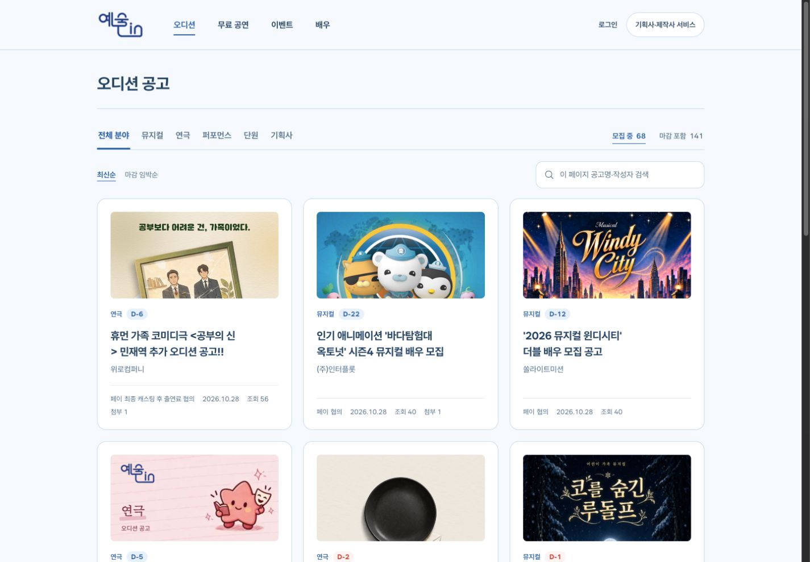
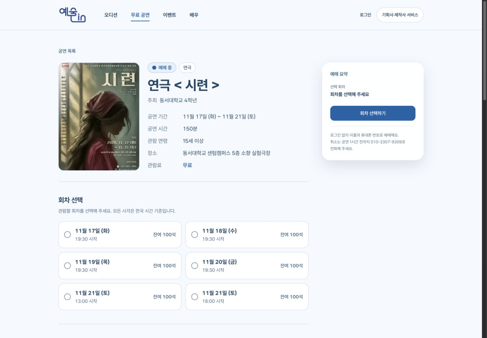
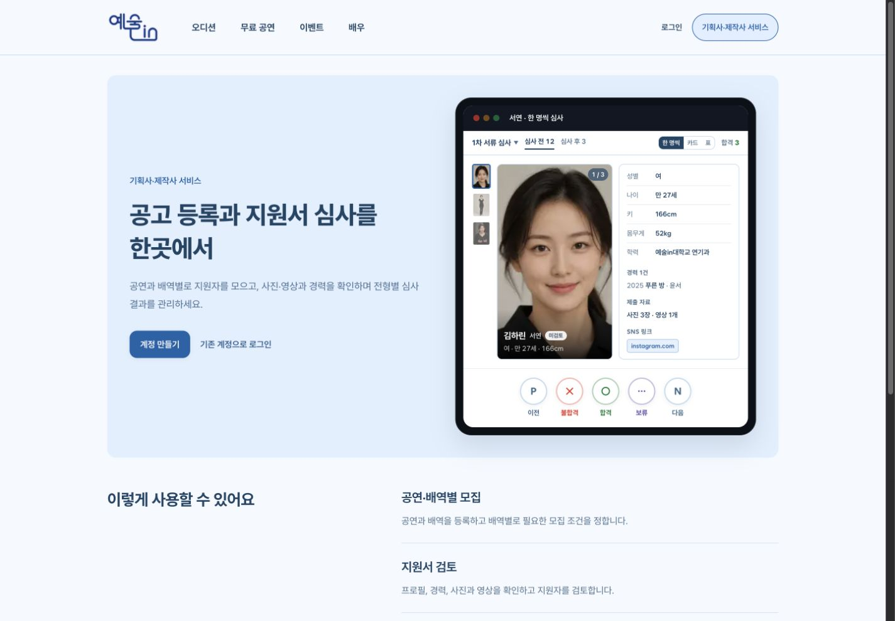
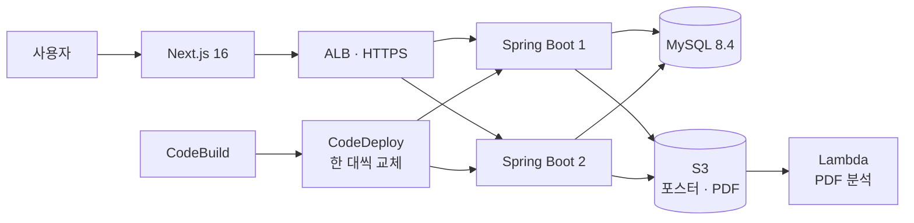

<p align="center">
  
</p>

<p align="center">
  <a href="https://yesulin.art"><b>🌐 yesulin.art</b></a> &nbsp;·&nbsp;
  <a href="./docs/README.md">📚 문서</a> &nbsp;·&nbsp;
  <a href="./backend/docs/api.md">🔌 API</a>
</p>

## 🎭 이런 문제가 있었어요

- 오디션 공고는 여러 커뮤니티와 SNS에 **흩어져** 있습니다.
- 지원서는 **메일로 받은 PDF**로 쌓이고, 공연사는 배역별로 직접 정리합니다.
- 합격 안내와 다음 일정은 **한 명씩 문자**로 보냅니다.

## 💡 예술IN은 이렇게 풀었어요

| | 배우 | 공연사 |
| --- | --- | --- |
| **찾기** | 흩어진 오디션 공고를 한 목록에서 | 공연·공고·배역을 한 번에 등록 |
| **지원** | 소셜 로그인 후 바로 지원, 내 배우 페이지 | 메일로 받은 PDF도 심사함에 올려 배역별 정리 |
| **심사** | 제출 이력과 결과 확인 | 차수별 합격·보류, 배역 단위 심사 종료 |
| **그다음** | 오디션 일정과 안내 문자 받기 | 합격자 일정표와 안내 문자 |

그 밖에 무료 공연 예매, 익명 커뮤니티, 이벤트 참가 모집도 제공해요.

## 🙋 배우들이 직접 써 봤어요

**예술IN 네트워킹 데이 vol.1** · 2026.11.9 · 남극장 공동 주최

| 23명 | 19명 | 27개 | 21 / 22 |
| :---: | :---: | :---: | :---: |
| 현장 참석<br/><sub>배우 20 · 공연사 3</sub> | 행사 중<br/>배우 페이지 등록 | 23분 동안<br/>수다방에 올라온 글 | 설문 '매우 만족'<br/><sub>재참여 의향 22 / 22</sub> |

참가 신청 → 입금 확인 → QR 프로필 명함 → 배우 페이지까지, 행사 운영을 예술IN 기능으로 했어요.
수다방에 올라온 글 27개 중 11개는 캐스팅·프로필·커리어에 대해 현업자에게 묻는 질문이었고, 현장에서 바로 답을 들었어요.

**행사 밖에서도** 11월 들어 한 주에 **334명**이 예술IN에서 오디션 공고를 보고, 그중 **4명 중 1명 이상**이 다음 주에도 다시 와요.
최근 28일 동안 **1.4천 명**이 방문해 평균 **2분 18초** 머물렀어요.

<sub>공고 조회자: PostHog, 2026.11.2–11.15 두 주 각각 334명 / 재방문: 10.26 주 145명 중 54명, 11.2 주 334명 중 85명 · 운영 기록만, 내부·테스트 제외 / 방문자: Google Analytics, 2026.10.21–11.17 · 모두 분석 동의 사용자 기준</sub>

## 📸 주요 화면

| 오디션 공고 | 무료 공연 예매 | 공연사 서비스 |
| :---: | :---: | :---: |
|  |  |  |

## 🔧 기술적 도전

<details open>
<summary><b>무중단 배포</b> — 배포 중 실패 222건 → 0건</summary>

서버 1대 일괄 배포를 측정했을 때 503 응답이 222건 나왔고, 가장 길게 끊긴 시간은 164.5초였어요.
2대를 두고 한 대씩 교체하도록 바꾼 뒤에는 측정한 배포·롤백 6번이 모두 실패 0건이었습니다.
→ [검증 기록](./design/zero-downtime-deployment-record.md)

</details>

<details>
<summary><b>운영 DB 백업과 복구</b> — 백업 0개 → 매일 자동, 복구 21초</summary>

운영 DB에 백업이 하나도 없었어요. 지금은 매일 03:15 논리 백업과 매주 스냅샷을 만들고, 처리방침에 맞춰 90일만 보관합니다.
백업본으로 실제 복구도 해 봤고 21초가 걸렸어요(DB 4.5MiB 기준).
→ [적용 기록](./design/db-backup-record.md)

</details>

<details>
<summary><b>운영 비용 줄이기</b></summary>

→ [계획](./design/operating-cost-reduction-plan.md) · [작업 기록](./design/operating-cost-work-log.md)

</details>

## 🏗 아키텍처



## 🧰 기술 스택

| | |
| --- | --- |
| **Frontend** |      |
| **Backend** |     |
| **Infra** |   |
| **Analytics** |  |

## 👥 팀원

|  |  |  |  |  |
| :---: | :---: | :---: | :---: | :---: |
| [@minzzun99](https://github.com/minzzun99) | [@jihwankim128](https://github.com/jihwankim128) | [@mvg01](https://github.com/mvg01) | [@haechanmoon](https://github.com/haechanmoon) | [@simhokyung](https://github.com/simhokyung) |

<p align="center"><sub>우아한테크코스 8기 백엔드 크루</sub></p>

## 🛠 개발

Node.js 24와 Java 25가 필요합니다.

```bash
npm install                                  # 처음 한 번, Git hook 설치
cd frontend && npm install && npm run dev    # 프론트엔드
cd backend && ./gradlew bootRun              # 백엔드 (local 프로필)
```

백엔드는 `config/server/local.env`가 있어야 시작됩니다. 환경 변수, 인증 메일, 검증 명령, Docker 통합 실행은
[로컬 개발 안내](./docs/local-development.md)를 따릅니다.

```text
backend/    Spring Boot API와 도메인·인프라
frontend/   Next.js UI와 선택적 MSW 시나리오
docs/       영역을 가로지르는 확정 규칙과 작업 보류 목록
ops/        백업·모니터링 스크립트
```

- 제품 규칙은 [공통 도메인](./docs/domain.md), 실제 HTTP 계약은 [백엔드 API](./backend/docs/api.md)가 정본입니다.
  구현되지 않은 내용은 [미구현](./docs/implementation-gaps.md), 결정되지 않은 내용은 [미결정](./docs/pending-decisions.md)에만 둡니다.
- 작업에 필요한 문서는 [문서 라우터](./docs/README.md)에서 고르고, 작업 평가와 PR 기록은 [공통 평가 규칙](./docs/agent-review.md)을 따릅니다.
