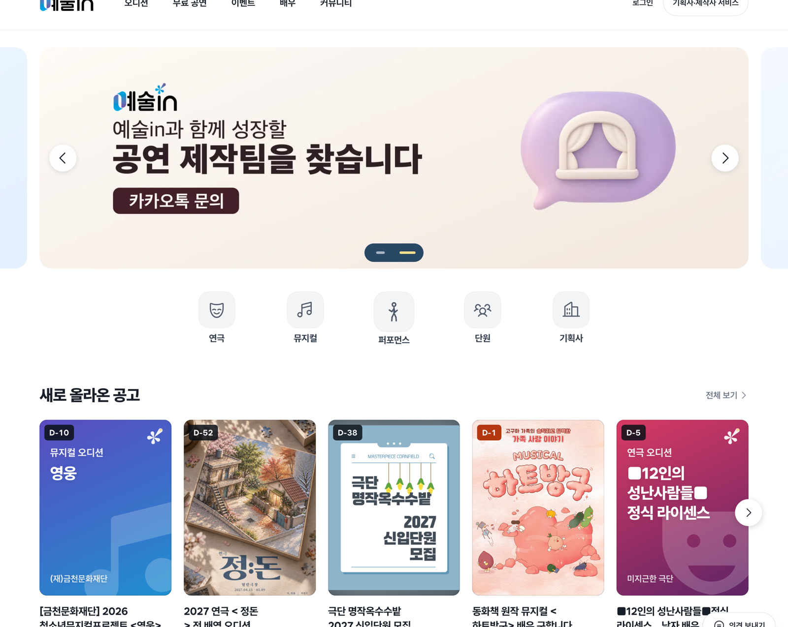
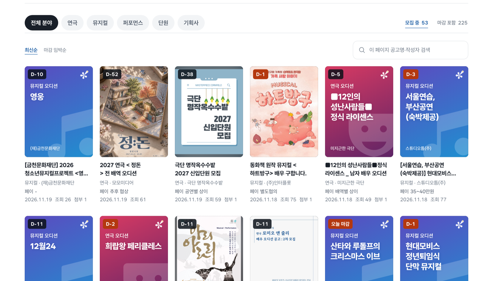
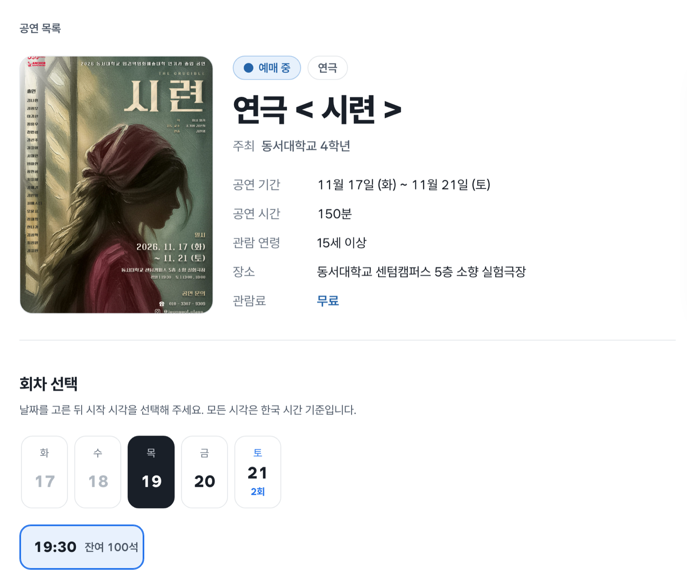
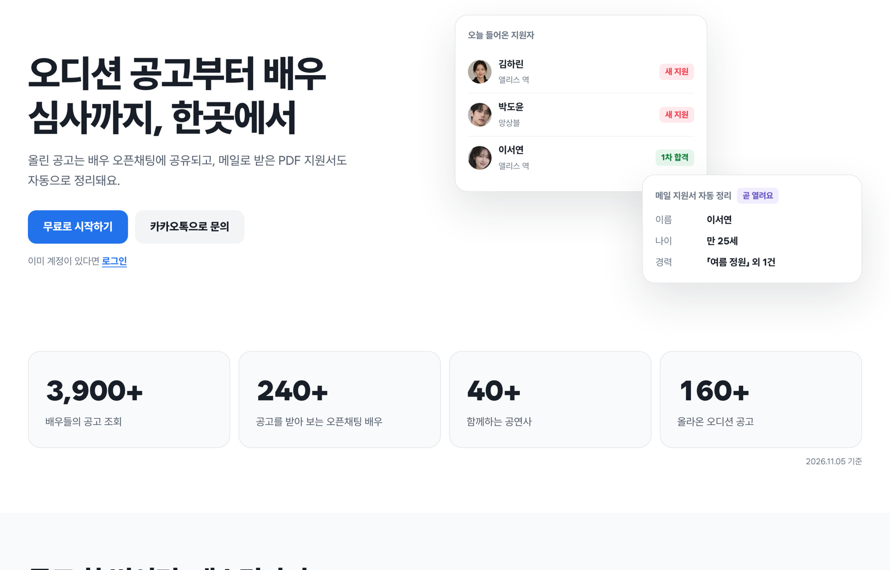
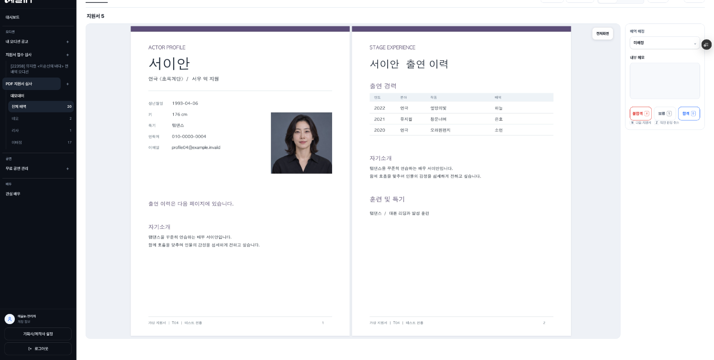
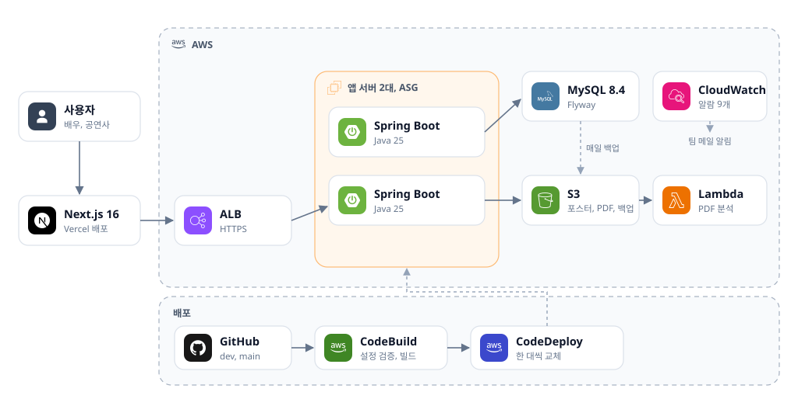

<p align="center">
  
</p>

<p align="center">
  <a href="https://yesulin.art"><b>yesulin.art</b></a>&nbsp;&nbsp;&nbsp;&nbsp;
  <a href="./docs/README.md">문서</a>&nbsp;&nbsp;&nbsp;&nbsp;
  <a href="./backend/docs/api.md">API</a>&nbsp;&nbsp;&nbsp;&nbsp;
  <a href="https://sprint.yesulin.art">스프린트 기록</a>
</p>

## 만든 이유

- 오디션 공고는 여러 커뮤니티와 SNS에 **흩어져** 있습니다.
- 지원자는 공연사마다 다른 **HWP 양식**을 내려받아 채우고, 메일로 보냅니다.
- 지원서는 **메일로 받은 PDF**로 쌓이고, 공연사는 배역별로 직접 정리합니다.
- 합격 안내와 다음 일정은 **한 명씩 문자**로 보냅니다.

## 무엇을 하나

| | 배우 | 공연사 |
| --- | --- | --- |
| **찾기** | 흩어진 오디션 공고를 한 목록에서 | 공연, 공고, 배역을 한 번에 등록 |
| **지원** | 공고에 안내된 이메일로 지원하고, 배우 페이지로 프로필을 보여 주기 | 메일로 받은 PDF 지원서를 심사함에 올려 배역별로 정리 |
| **심사와 안내** | 합격하면 안내 문자로 다음 일정 확인 | 차수별 합격과 보류, 합격자 일정표와 안내 문자 |

그 밖에 무료 공연 예매, 익명 커뮤니티, 이벤트 참가 모집도 제공해요.

## 배우와 공연사를 직접 만나게 했어요

온라인 공고만으로는 배우와 공연사가 서로를 알 기회가 많지 않아요.
그래서 2026년 11월 9일, 남극장과 함께 배우와 공연사 관계자가 한자리에서 만나는 **예술IN 네트워킹 데이 vol.1**을 열었어요.

| 23명 | 19명 | 27개 | 21 / 22 |
| :---: | :---: | :---: | :---: |
| 현장 참석<br/><sub>배우 20, 공연사 3</sub> | 행사 중<br/>배우 페이지 등록 | 23분 동안<br/>수다방에 올라온 글 | 설문 '매우 만족'<br/><sub>재참여 의향 22 / 22</sub> |

참가 신청과 입금 확인, QR 프로필 명함, 배우 페이지까지 행사 운영을 예술IN 기능으로 했어요.
수다방에 올라온 글 27개 중 11개는 캐스팅, 프로필, 커리어에 대해 현업자에게 묻는 질문이었고 현장에서 바로 답을 들었어요.

최근 한 달 동안 **1.4천 명**이 예술IN을 방문했어요.

<sub>방문자 수: Google Analytics, 2026년 10월 21일부터 11월 17일까지, 분석에 동의한 사용자 기준</sub>

## 주요 화면

**홈**



**오디션 공고 보기**



**무료 공연 예매**



**공고 등록부터 심사까지**





## 기술적 도전

네 번의 스프린트 동안 운영하면서 부딪힌 문제를 직접 재고, 고친 뒤 다시 쟀어요. 과정은 [스프린트 기록](https://sprint.yesulin.art)에 모두 남아 있어요.

| 스프린트 | 주제 | 결과 |
| :---: | --- | --- |
| 1 | 운영 환경 분리와 장애 알림 | DEV와 PROD 분리, 알람 9개, DB 메모리 부족 종료 3회에서 0회로 |
| 2 | 부하 테스트와 병목 개선 | 같은 100RPS에서 p95 10,001ms에서 58ms로, 400RPS 60초 실패 0건 |
| 3 | 무중단 배포와 롤백 | 배포 중 실패 222건에서 0건으로, 배포와 롤백 6번 모두 실패 0건 |
| 4 | 운영 DB 백업과 복구 | 백업 0개에서 매일 자동 백업으로, 복구 21초 |
| 4 | 인증, 인가와 비밀값 점검 | 남의 자원 요청 13건 모두 거부, 커밋 772개와 로그 95만 줄에서 비밀값 0건 |

<details>
<summary><b>1. 운영 환경 분리와 장애 알림</b></summary>

<br/>

개발 서버 하나가 실제 요청까지 받고 있어서, 배포 실패나 DB 구조 변경이 그대로 서비스에 반영될 수 있었어요.
DEV와 PROD를 서버, DB, 설정까지 나누고 CloudWatch 알람 9개가 장애와 복구를 팀 메일로 알리게 했어요.

알림이 없던 때 PROD DB 서버가 메모리 부족으로 MySQL을 이틀 동안 세 번 강제 종료한 일이 있었어요.
메모리를 2GiB로 늘린 뒤로는 강제 종료가 한 번도 없었어요.

[모니터링 문서](./backend/docs/operations/monitoring.md)

</details>

<details>
<summary><b>2. 부하 테스트와 병목 개선</b></summary>

<br/>

공개 공고 목록 API에 100RPS를 보내자 요청 6,001건 중 3,512건이 실패했어요.
목록 조회가 COUNT를 세 번 반복하고 있었고, 이를 한 번으로 합치고 커버링 인덱스를 더했어요.

같은 100RPS에서 p95가 10,001ms에서 58ms로 줄었고, 실패는 0건이 됐어요.
작은 서버(micro)에서도 400RPS를 60초 동안 오류 없이 처리해, 운영 서버 사양을 낮춰 비용을 줄였어요.

[부하 테스트 보고서](https://sprint.yesulin.art/assets/s2/load-test-report.html)

</details>

<details>
<summary><b>3. 무중단 배포와 롤백</b></summary>

<br/>

서버 1대에 한꺼번에 배포할 때는 배포 중 503 응답이 222건 나왔고, 가장 길게 끊긴 시간은 164.5초였어요.
서버를 2대로 늘리고 한 대씩 교체하도록 바꾼 뒤, 측정한 배포와 롤백 6번이 모두 실패 0건이었어요.

첫 롤백은 같은 날 나간 컬럼 삭제 마이그레이션 때문에 실패했어요.
그 뒤로 DB 변경은 넓히고, 옮기고, 다음 배포에서 지우는 순서로 나누고, 컬럼 삭제가 섞인 PR은 CI가 막도록 했어요.

[검증 기록](./design/zero-downtime-deployment-record.md)

</details>

<details>
<summary><b>4. 운영 DB 백업과 복구</b></summary>

<br/>

운영 DB에 백업이 하나도 없었어요. 지금은 매일 03:15 논리 백업과 매주 스냅샷을 만들고, 처리방침에 맞춰 90일만 보관해요.
백업본으로 실제 복구를 해 보니 21초가 걸렸고, 표 85개의 행 수가 모두 일치했어요(DB 4.5MiB 기준).

[적용 기록](./design/db-backup-record.md)

</details>

<details>
<summary><b>5. 인증, 인가와 비밀값 점검</b></summary>

<br/>

다른 공연사의 공고와 PDF 심사, 관리자 API에 실제로 요청을 보내 13건이 모두 막히는 것을 확인했어요.
비로그인 요청은 401, 남의 공고와 심사는 404, 공연사가 부른 관리자 API는 403이었어요.

저장소 커밋 772개와 운영, 개발 로그 95만 줄에서 키, 토큰, 세션 값이 남아 있지 않은 것도 확인했어요.

[스프린트 4 기록](https://sprint.yesulin.art/sprint.html?n=4)

</details>

## 아키텍처

<picture>
  <source media="(prefers-color-scheme: dark)" srcset="docs/images/readme/architecture-dark.svg">
  
</picture>

## 기술 스택

| | |
| --- | --- |
| **Frontend** |      |
| **Backend** |     |
| **Infra** |   |
| **Analytics** |  |

## 팀원

<div align="center">

|  |  |  |  |  |
| :---: | :---: | :---: | :---: | :---: |
| [@minzzun99](https://github.com/minzzun99) | [@jihwankim128](https://github.com/jihwankim128) | [@mvg01](https://github.com/mvg01) | [@haechanmoon](https://github.com/haechanmoon) | [@simhokyung](https://github.com/simhokyung) |

<sub>우아한테크코스 8기 백엔드 크루</sub>

</div>

## 개발

Node.js 24와 Java 25가 필요합니다.

```bash
npm install                                  # 처음 한 번, Git hook 설치
cd frontend && npm install && npm run dev    # 프론트엔드
cd backend && ./gradlew bootRun              # 백엔드 (local 프로필)
```

백엔드는 `config/server/local.env`가 있어야 시작됩니다. 환경 변수, 인증 메일, 검증 명령, Docker 통합 실행은
[로컬 개발 안내](./docs/local-development.md)를 따릅니다.

```text
backend/    Spring Boot API와 도메인, 인프라
frontend/   Next.js UI와 선택적 MSW 시나리오
docs/       영역을 가로지르는 확정 규칙과 작업 보류 목록
ops/        백업과 모니터링 스크립트
```

- 제품 규칙은 [공통 도메인](./docs/domain.md), 실제 HTTP 계약은 [백엔드 API](./backend/docs/api.md)가 정본입니다.
  구현되지 않은 내용은 [미구현](./docs/implementation-gaps.md), 결정되지 않은 내용은 [미결정](./docs/pending-decisions.md)에만 둡니다.
- 작업에 필요한 문서는 [문서 라우터](./docs/README.md)에서 고르고, 작업 평가와 PR 기록은 [공통 평가 규칙](./docs/agent-review.md)을 따릅니다.
